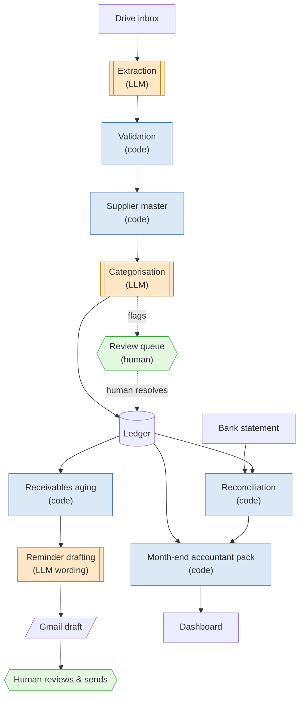
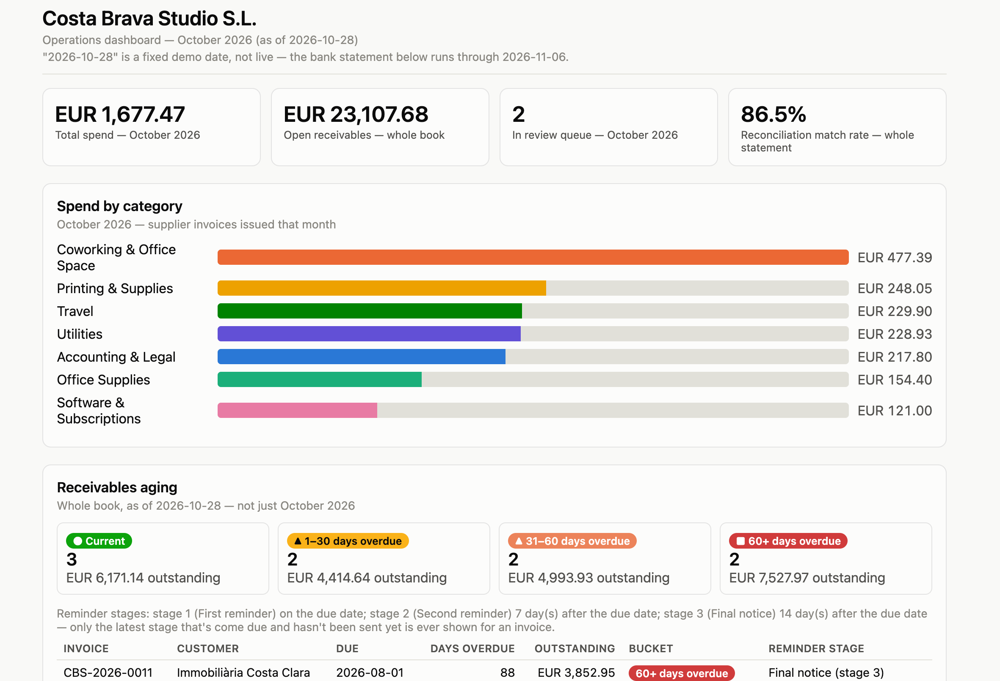

# Invoice Automation

An invoice and receipt pipeline for a fictional Barcelona studio that reads documents, validates and categorises them, tracks who owes money, reconciles the bank statement, and hands the accountant a clean month-end pack — with a human approving everything that leaves the building.

[](https://github.com/merkurmasha/invoice-automation/actions/workflows/ci.yml)
[](LICENSE)
[](https://merkurmasha.github.io/invoice-automation/dashboard/)

## The idea

Invoices and receipts land in a Google Drive folder for **Costa Brava Studio S.L.**, a fictional Barcelona company built for this portfolio project. The pipeline reads each one, checks it for problems (duplicates, math errors, missing fields), matches the supplier to a known identity, and files it under an expense category. From there it tracks which invoices are overdue and drafts reminder wording, matches the bank statement against what's owed, and assembles a month-end pack an accountant could actually use.

The core principle running through all of it: **the LLM only reads documents, categorises expenses, and drafts reminder wording** — everything else (arithmetic, duplicate detection, fuzzy supplier matching, aging, reconciliation) is deterministic, unit-tested code. And nothing is ever sent automatically: reminders are created as Gmail drafts only, for a human to review and send.

## Architecture



## Screenshots



Live dashboard, generated from synthetic data: <https://merkurmasha.github.io/invoice-automation/dashboard/>

## Results

All numbers below come from `evals/results/*.json`, produced by the offline eval harness in `evals/`. Nothing here is estimated.

| Measurement | Result | How it was measured |
| --- | --- | --- |
| Extraction (synthetic set) | 97.4% → 100% (448/460 → 460/460 fields) | `evals/run_eval.py` scoring prompt v1 vs. v2 field-by-field against `data/synthetic/answer_key.json` |
| Extraction (held-out set) | 98.6% (138/140 fields) | Same harness, prompt v2, against `data/heldout/`, documents the extraction prompt was never tuned on |
| Supplier merging (synthetic + held-out) | 0 false merges, 0 missed merges | `evals/run_supplier_eval.py` comparing assigned supplier IDs against known ground truth |
| Categorisation (synthetic set) | 87% (40/46 lines) | Same harness; lines it got wrong were flagged into the review queue for low confidence, not shipped silently |
| Categorisation (held-out set) | 64% (9/14 lines) | Same harness, held-out suppliers the categoriser had never seen |
| Reconciliation | 36/36 correctly matched, 0 false matches | `evals/run_reconcile_eval.py` against 37 synthetic bank statement lines (one line is genuinely unmatched by design, and was correctly left that way) |

Supplier matching and categorisation were both tuned against the synthetic set, so the held-out numbers — merging still at 0 false/0 missed, categorisation down to 64% — are the fairer read on how this would do on suppliers it hasn't seen before.

## Limitations

- **Synthetic data only.** Every invoice, receipt, supplier, and bank line in this repo is fictional. No real company or financial data anywhere, by design (see `CLAUDE.md`).
- **n8n runs locally only.** The workflows in `n8n/` run on whatever machine has `n8n/start.sh` running — there's no cloud scheduler, so nothing processes while the laptop is asleep or off.
- **The categoriser sees only the supplier name** and, when available, a one-line description — never the full invoice text or spending history.
- **The month-end pack uses the synthetic answer key's categories and canonical supplier names**, not the categoriser's own live output — it's a demo of the pack format, not a live bookkeeping run.
- **Filenames aren't actually changed.** `scripts/process_invoice.py` computes a standardised filename and writes it into the intake sheet/ledger, but the source file in Drive keeps its original name (the month-end pack's own `documents/` copies are the one place files get renamed).

## How to run

```bash
# Install the project and its dev/test dependencies
pip install -e ".[dev]"

# Run the test suite (266 tests; none of them call the Claude API — it's mocked everywhere outside evals/)
pytest

# Run one invoice or receipt through extraction -> validation -> supplier match -> categorisation
.venv/bin/python -m scripts.process_invoice path/to/file.pdf

# Draft today's overdue-payment reminders (writes .md drafts under data/drafts/, never sends anything)
.venv/bin/python -m scripts.receivables_today

# Build the month-end accountant pack for a given month
python -m src.pack.build --month 2026-09 --out data/packs/

# Regenerate the dashboard (dashboard/index.html, no API key needed)
python -m scripts.build_dashboard

# Run the n8n workflows locally (watches Drive, writes to Sheets, drafts in Gmail)
n8n/start.sh   # then see docs/n8n-setup.md to connect your own Google/Gmail account
```

## Project structure

```
src/
  extract/       Reads invoices/receipts into structured data (LLM)
  validate/      Field checks, duplicate detection (deterministic)
  suppliers/     Supplier identity matching (deterministic) + categorisation (LLM)
  receivables/   Aging and reminder scheduling (deterministic) + draft wording (LLM)
  reconcile/     Bank-statement matching (deterministic)
  pack/          Month-end accountant pack builder (deterministic)
  synthetic/     Generator for this project's fictional invoices, receipts, and bank data
scripts/         CLI wrappers n8n calls, plus the dashboard builder
evals/           Offline eval harness — scores extraction/suppliers/categorisation/reconciliation
n8n/             Local n8n workflows (intake, receivables, month-end pack) and the start script
dashboard/       Committed, deterministically-generated dashboard/index.html
docs/            n8n setup guide and the project case study
data/            Synthetic/held-out documents, answer key, caches, and generated packs
tests/           Unit tests — the Claude API is always mocked here
```

## Links

- Live dashboard: <https://merkurmasha.github.io/invoice-automation/dashboard/>
- [n8n setup guide](docs/n8n-setup.md)
- [Case study](docs/case-study.md)

## License

See [LICENSE](LICENSE).
